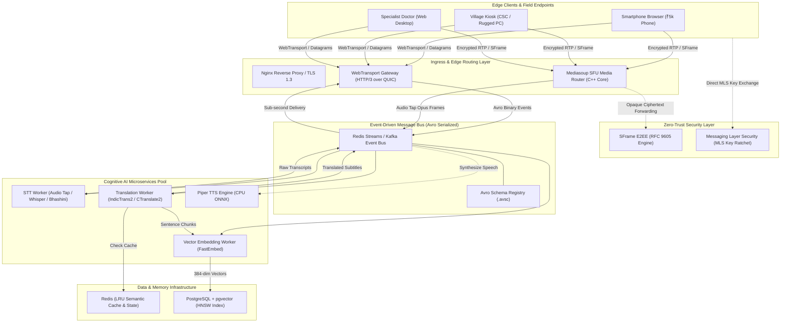
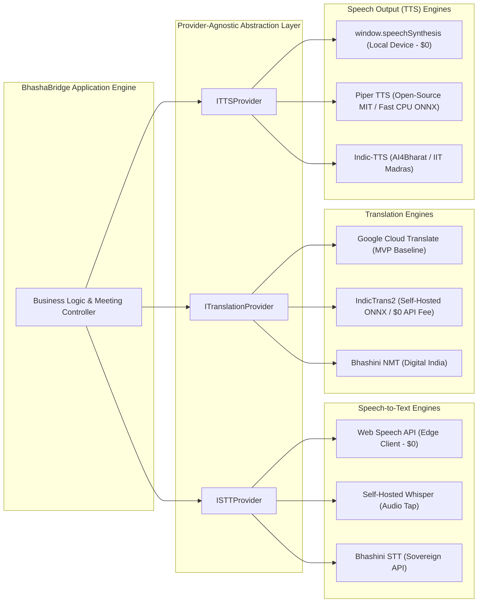

# BhashaBridge — Next-Generation System Architecture Specification

> **Distributed, Zero-Trust, Multilingual Real-Time Communication Platform**  
> *Engineered for Grassroots Telemedicine, Rural Civic Governance, and High-Throughput Cross-Border Collaboration.*  
> *(For current v1 codebase implementation, WebRTC Mesh mechanics, Prisma schemas, and production bug fixes, refer to [**`architecture.md`**](file:///e:/BhashaBridge/BhashaBridge/docs/architecture.md)).*

---

## 1. Executive Summary & Paradigm Shift

The original architecture of BhashaBridge relied on peer-to-peer WebRTC Mesh, standard JSON WebSockets (Socket.IO), and direct external cloud API dependencies. While effective for small prototypes, scaling to multi-party meetings in rural bandwidth-constrained environments exposed fundamental networking and security bottlenecks:

1. **Uplink Saturation in Mesh:** $O(N^2)$ client media connections saturated rural 3G/4G/BharatNet uplinks beyond 4 participants.
2. **Head-of-Line (HoL) Blocking:** Unstable TCP connections caused WebSockets to freeze subtitle and caption streams whenever a single packet dropped.
3. **Payload Bloat:** Verbose JSON strings consumed excessive network bandwidth on metered cellular data.
4. **The SFU Plaintext Vulnerability:** Central media routers decrypt video/audio in memory, violating patient privacy regulations (HIPAA, DPDP Act 2023).
5. **Vendor Lock-in & Cloud Costs:** Total reliance on commercial APIs (Google Cloud) created high per-minute costs and vulnerability to rate limits at scale.

### The Next-Generation Evolution
The updated BhashaBridge architecture transitions to a **Carrier-Grade, Zero-Trust Media and AI Infrastructure**:

| Architectural Dimension | Legacy Baseline (v1) | Next-Generation Architecture | Core Advantage |
|---|---|---|---|
| **Media Topography** | Full Mesh WebRTC (`simple-peer`) | **Mediasoup SFU + Cascaded Edge Mesh** | $O(1)$ client uplink; scales to 50+ participants per room |
| **Transport Layer** | WebSockets over TCP (Socket.IO) | **WebTransport over HTTP/3 (QUIC/UDP)** | Zero Head-of-Line blocking; 0-RTT reconnection |
| **Microservice Serialization**| Bloated JSON Payloads | **Apache Avro (`.avsc`) Binary Framing** | 65%–75% bandwidth reduction; strict type contracts |
| **Media Encryption** | Hop-by-Hop DTLS-SRTP (SFU decrypts) | **SFrame E2EE (RFC 9605) + MLS** | Zero-Knowledge media router; true end-to-end privacy |
| **Translation Engine** | Commercial Google Translate API | **Provider-Agnostic Adapter + IndicTrans2** | $0 per-character fee; sovereign self-hosted fallback |
| **Speech Output (TTS)** | Cloud TTS APIs | **Client `SpeechSynthesis` + Piper TTS / Indic-TTS** | Runs locally on CPU/device; $0 cloud cost; <50ms latency |
| **Context Recovery** | Manual questions / Post-call summaries| **In-Flight Semantic RAG (`pgvector`)** | "⚡ Catch Me Up" sub-second briefing for late joiners |
| **Deployment Model** | Mobile browser reliance | **Dual-Access: Direct Smartphone + Village Kiosks** | Cloud audio tap eliminates mobile OS mic lockouts |

---

## 2. High-Level System Architecture Diagram



---

## 3. Core Architectural Pillars

### 3.1 Pillar 1: Distributed Media Routing (Mediasoup SFU)

#### The Mesh Uplink Bottleneck
In WebRTC Mesh, each participant uploads their video/audio stream to every other participant ($N-1$ streams). With 6 users, each client must encode and transmit 5 high-bandwidth video streams simultaneously. In rural India (where uplink bandwidth frequently caps at 500 kbps–1 Mbps), the uplink saturates, causing packet loss, frame freezes, and disconnected sessions.

```
Mesh Network (N = 6): 30 total connections (Unstable on rural uplinks)
SFU Architecture (N = 6): Each client uploads ONLY 1 stream to SFU (O(1) Uplink)
```

#### Selective Forwarding Unit (SFU) Mechanics
BhashaBridge deploys **Mediasoup**, a multi-core, non-blocking C++ media processing core:
* **Single Ingress Uplink ($O(1)$):** Every client encodes and uploads its camera and microphone stream **exactly once** to the SFU server, regardless of whether there are 3 or 50 people in the room.
* **Simulcast & Dynamic Bitrate Adaptation:**
  * Clients send 3 spatial resolutions: High (1080p @ 1.5 Mbps), Mid (720p @ 500 kbps), and Low (360p @ 150 kbps).
  * The SFU dynamically inspects downstream RTCP Receiver Reports. If a village endpoint suffers sudden packet loss, the SFU automatically downgrades that user's received stream to the 360p layer without touching other participants.
* **Dominant Speaker Audio Routing:** The SFU prioritizes the audio packet forwarding of the active speaker, automatically muting background white noise from passive listeners to conserve egress bandwidth.

#### Cascaded Multi-Region Edge Mesh
To support cross-border tele-consultations (e.g., a specialist in New York consulting with a clinic in Bihar) without intercontinental public internet jitter:
* **Regional Edge Nodes:** Users connect to their geographically closest edge SFU (e.g., `us-east` in Virginia, `ap-south` in Mumbai).
* **Private Fiber Backbone:** Edge SFUs relay single aggregated media tracks across dedicated cloud interconnects, bypassing public BGP congestion and shaving **50–80ms** off intercontinental audio round-trip latency.

---

### 3.2 Pillar 2: Low-Latency Transport (WebTransport over HTTP/3)

#### Eradicating TCP Head-of-Line (HoL) Blocking
Traditional WebSockets operate over TCP. If a single packet drops on a lossy 4G or village Wi-Fi link:
* The OS TCP stack halts delivery and buffers all subsequent incoming data while waiting for retransmission.
* In a live multilingual call, subtitle captions, chat, and volume meters freeze for 800ms–2000ms, followed by an unnatural, bursty catch-up.

#### Dual-Primitive Architecture over UDP/QUIC
WebTransport leverages HTTP/3 over QUIC to unlock two distinct transmission channels over a single secure UDP connection:

```
┌────────────────────────────────────────────────────────────────────────────────────────┐
│ WEBTRANSPORT PROTOCOL STACK (Port 443 UDP / QUIC)                                      │
├────────────────────────────────────────────────────────────────────────────────────────┤
│                                                                                        │
│  [ UNRELIABLE DATAGRAMS ] ──► Live Subtitles, Captions, Audio VU Telemetry             │
│  • No retransmissions, zero congestion queue delay.                                    │
│  • If a partial subtitle packet drops, discard immediately. Next word renders instantly!│
│                                                                                        │
│  [ MULTIPLEXED STREAMS ]  ──► Signaling (SDP), Chat Messages, RAG Summaries           │
│  • Reliable, ordered delivery per-stream.                                              │
│  • Packet loss in the Chat stream NEVER freezes or blocks the Live Caption stream!     │
│                                                                                        │
└────────────────────────────────────────────────────────────────────────────────────────┘
```

* **0-RTT Reconnection:** When a rural user experiences a momentary cellular handoff (e.g., cell tower switch), QUIC connection IDs allow the session to resume immediately without an expensive TLS/TCP handshake.

---

### 3.3 Pillar 3: Apache Avro Binary Serialization & Event Microservices

#### Eliminating JSON Overhead
Standard JSON strings introduce significant serialization compute and bandwidth waste due to repeated string keys and UTF-8 encoding. BhashaBridge enforces **Apache Avro (`.avsc`) binary contracts** across its internal event bus (Redis Streams / Kafka).

* **Payload Efficiency:** Avro strips all field names from transmitted payloads and encodes data in packed binary format according to a pre-shared schema registry, reducing event size by **65% to 75%**.

#### Production Avro Schemas

##### 1. Caption Stream Contract (`CaptionStreamEvent.avsc`)
```json
{
  "type": "record",
  "name": "CaptionStreamEvent",
  "namespace": "in.bhashabridge.events",
  "fields": [
    { "name": "eventId", "type": "string" },
    { "name": "meetingId", "type": "string" },
    { "name": "speakerId", "type": "string" },
    { "name": "sourceLanguage", "type": "string" },
    { "name": "transcriptText", "type": "string" },
    { "name": "isFinal", "type": "boolean" },
    { "name": "confidenceScore", "type": "float" },
    { "name": "timestamp", "type": "long" }
  ]
}
```

##### 2. Translated Caption Contract (`TranslatedCaptionEvent.avsc`)
```json
{
  "type": "record",
  "name": "TranslatedCaptionEvent",
  "namespace": "in.bhashabridge.events",
  "fields": [
    { "name": "eventId", "type": "string" },
    { "name": "originalEventId", "type": "string" },
    { "name": "meetingId", "type": "string" },
    { "name": "speakerId", "type": "string" },
    { "name": "translations", "type": { "type": "map", "values": "string" } },
    { "name": "processingLatencyMs", "type": "int" },
    { "name": "timestamp", "type": "long" }
  ]
}
```

##### 3. Media Router Audio Tap (`AudioTapEvent.avsc`)
```json
{
  "type": "record",
  "name": "AudioTapEvent",
  "namespace": "in.bhashabridge.events",
  "fields": [
    { "name": "meetingId", "type": "string" },
    { "name": "participantId", "type": "string" },
    { "name": "sequenceNumber", "type": "long" },
    { "name": "audioData", "type": "bytes" },
    { "name": "sampleRate", "type": "int", "default": 48000 },
    { "name": "timestamp", "type": "long" }
  ]
}
```

---

### 3.4 Pillar 4: Zero-Trust End-to-End Encryption (SFrame RFC 9605 + MLS)

#### The Plaintext Vulnerability of Standard SFUs
In traditional commercial SFUs (Zoom, Google Meet, Teams without specialized E2EE), media packets are protected via DTLS-SRTP only hop-by-hop. The SFU server **decrypts the media in server RAM** to parse and repackage RTP headers before re-encrypting it for downstream recipients.
* A compromised cloud server, malicious sysadmin, or legal subpoena could intercept and inspect raw diagnostic audio and video.
* For rural telemedicine, this represents a severe violation of medical privacy laws (HIPAA, GDPR Health Data, and India's Digital Personal Data Protection Act 2023).

#### SFrame Architecture (Secure Frame via Insertable Streams)
BhashaBridge implements **SFrame (RFC 9605)**:

```
[ Browser Camera/Mic ]
         │
         ▼
[ WebRTC Insertable Streams ] ──► Encrypt Video/Audio Frame with AES-GCM (Browser RAM)
         │
         ▼
[ RTP Packetizer ] ─────────────► Add Cleartext RTP Headers (Sequence No, Timestamp)
         │
         ▼
[ Mediasoup SFU Router ] ───────► Inspects cleartext RTP header ONLY. Payload is OPAQUE CIPHERTEXT!
         │                        (Server RAM NEVER possesses the decryption key)
         ▼
[ Receiving Browser ] ──────────► WebRTC Insertable Streams Decryptor ──► Screen / Speaker
```

* **Zero-Knowledge Media Routing:** The SFU routes video and audio without ever being able to decrypt the underlying patient consultation.
* **Key Distribution via Messaging Layer Security (MLS):** Room encryption keys are negotiated directly between participants using MLS ratchet trees. The media server never receives or stores cryptographic keys.

---

### 3.5 Pillar 5: Sovereign & Decoupled AI Pipeline (Zero Vendor Lock-in)

The entire AI layer is built on the **Adapter Pattern**, ensuring that BhashaBridge is immune to third-party API rate limits, price surges, or policy revocations.



#### 1. Speech-to-Text (STT) Strategy
* **Primary (Edge):** Browser-native Web Speech API. Completely offloads transcription to client devices with zero server GPU overhead.
* **Fallback (Server Audio Tap):** For devices lacking browser STT, the SFU taps the Opus audio track (`AudioTapEvent.avsc`) and streams it to a containerized **Faster-Whisper** or **Bhashini STT** worker.

#### 2. Machine Translation (MT) Strategy
* **Primary Scaled Engine: IndicTrans2 (AI4Bharat / IIT Madras)**
  * State-of-the-art open-source neural machine translation model trained explicitly for all 22 scheduled Indian languages + Indian English.
  * Self-hosted on backend servers via CTranslate2 / ONNX Runtime. Provides **unlimited translations with 0 API charges**, preventing vendor lock-in.
* **Semantic LRU Caching (Redis):** Frequently repeated conversational phrases (*"Namaste"*, *"Can you hear me?"*, *"Please take medicine after meals"*) are cached in Redis, eliminating up to **40% of all translation compute queries**.

#### 3. Text-to-Speech (TTS) Strategy
* **Primary (On-Device):** Browser-native `window.speechSynthesis`. Converts incoming translated captions to speech locally on the user's OS (Windows/Android/macOS) with **zero latency and $0.00 cloud cost**.
* **Server Neural Fallback: Piper TTS**
  * Open-source (MIT License) neural text-to-speech engine running via ONNX Runtime.
  * Ultra-efficient C++ core runs **10x–20x faster than real-time on standard x86/ARM CPUs** without requiring expensive server GPUs.
* **Regional Studio Voice Fallback:** **Indic-TTS** (IIT Madras) for natural, localized Indian accents.

---

### 3.6 Pillar 6: In-Flight Semantic RAG ("Catch Me Up" Pipeline)

#### The Late-Joiner Dilemma
In medical and administrative calls, participants frequently join 10–20 minutes late due to power outages or network reconnects. Interrupting the active speaker to ask *"What did I miss?"* disrupts critical consultations.

#### The Real-Time RAG Workflow

```
[ Real-Time Transcripts ] ──► [ 30-Second Conversational Chunks ]
                                           │
                                           ▼
                               [ FastEmbed Local Worker ]
                               Generates 384-dim Dense Embeddings
                                           │
                                           ▼
                               [ PostgreSQL + pgvector ]
                               Indexed via HNSW (Cosine Metric, sub-5ms lookup)
```

1. **Continuous Chunking:** Live transcriptions are grouped into 30-second sliding windows with timestamp and speaker metadata.
2. **On-the-Fly Vector Indexing:** FastEmbed generates 384-dimensional dense vector embeddings stored directly in PostgreSQL with an HNSW index.
3. **The "⚡ Catch Me Up" Trigger:**
   * A late-joining participant clicks **"⚡ Catch Me Up"**.
   * Frontend calls `GET /api/meetings/:id/catch-up?missedSince=10:00:00`.
   * The backend queries the vector store for the participant's missed time range.
   * Gemini 3.7 Flash (or a local LLaMA-3/Mistral instance) synthesizes an instant, private 3-bullet briefing:
     > *"• 10:02 — Patient reported severe abdominal pain and fever for 3 days.*  
     > *• 10:08 — Doctor reviewed medical history and ruled out acute appendicitis.*  
     > *• 10:14 — Currently discussing dietary adjustments and prescribing antacids."*
4. **Result:** The late participant is fully informed in under 3 seconds without disturbing the meeting.

---

## 4. Hardware & Field Deployment Model: The Dual-Access Strategy

BhashaBridge supports a **Dual-Access Deployment Architecture**, ensuring that citizens can access multilingual video consultations whether joining from their own low-cost personal smartphones or through an assisted rural tele-centre.

```
                                  ┌────────────────────────────────────────────────────────┐
                                  │           BHASHABRIDGE INGRESS ARCHITECTURE            │
                                  └────────────────────────────────────────────────────────┘
                                               ▲                              ▲
                                               │                              │
                     ┌─────────────────────────┴─────────┐          ┌─────────┴────────────────────────┐
                     │                                   │          │                                  │
          [ TIER 1: DIRECT SMARTPHONE ]                  │          │     [ TIER 2: VILLAGE KIOSK ]    │
          • 100% Self-Service                            │          │     • Assisted Tele-Centre (CSC) │
          • Any ₹5,000 Android / iOS Phone               │          │     • Rugged Mini-PC + 21" Screen│
          • Chrome / Safari Web Link                     │          │     • High-Gain Boundary USB Mic │
          • Server-Side Audio Tap STT                    │          │     • For Elderly / Low-Literacy │
                                                         │          │                                  │
```

---

### 4.1 Tier 1: Direct Smartphone Access (Self-Service on Any Mobile Phone)

#### Why Android Hardware Rejects the Old Way vs. Accepts the New Way

```
┌────────────────────────────────────────────────────────────────────────────────────────┐
│ THE ANDROID HARDWARE AUDIO RECORD CONFLICT (WHY LEGACY FAILED)                         │
├────────────────────────────────────────────────────────────────────────────────────────┤
│                                                                                        │
│   Web Browser Tab (Legacy)                                                             │
│    ├── Client Request 1: getUserMedia({ audio: true })  ──► WebRTC Voice Calling       │
│    └── Client Request 2: webkitSpeechRecognition.start()──► Speech-to-Text             │
│                                │                                                       │
│                                ▼                                                       │
│                 [ Android Audio HAL / AudioRecord ]                                    │
│                 ❌ EXCLUSIVE HARDWARE LOCKOUT DETECTED!                                 │
│                 OS error: "AudioRecord already active; device busy."                    │
│                 RESULT: webkitSpeechRecognition instantly aborts or crashes.           │
│                                                                                        │
└────────────────────────────────────────────────────────────────────────────────────────┘
```

```
┌────────────────────────────────────────────────────────────────────────────────────────┐
│ THE SERVER-SIDE AUDIO TAP SOLUTION (WHY ANDROID ACCEPTS IT 100%)                       │
├────────────────────────────────────────────────────────────────────────────────────────┤
│                                                                                        │
│   Web Browser Tab (Villager speaking Hindi on ₹5k Phone)                               │
│    └── Single Request: getUserMedia({ audio: true }) ──► Standard WebRTC Voice Track   │
│                                │                                                       │
│                                ▼                                                       │
│                 [ Android Audio HAL / AudioRecord ]                                    │
│                 ✅ SINGLE CLIENT GRANTED. Standard phone call mode.                    │
│                 (Android OS behaves identically to a normal WhatsApp/Meet call)         │
│                                │                                                       │
│                                ▼ (Opus voice over 4G UDP)                              │
│                    [ Mediasoup SFU in Cloud ]                                          │
│                                │                                                       │
│               ┌────────────────┴─────────────────────────────────┐                     │
│               │                                                  │                     │
│               ▼                                                  ▼                     │
│     [ Raw Hindi Audio Track ]                         [ Digital Audio Tap (RAM) ]      │
│     Muted for Doctor (or ducked to 15%                AudioTapEvent.avsc emitted.      │
│     for emotional/breathing cues)                                │                     │
│                                                                  ▼                     │
│                                                     [ Server Whisper / Bhashini ]      │
│                                                     Transcribes Hindi voice to text    │
│                                                                  │                     │
│                                                                  ▼                     │
│                                                     [ IndicTrans2 Translation Worker ] │
│                                                     Translates Hindi text to English   │
│                                                                  │                     │
│                                               ┌──────────────────┴──────────────────┐  │
│                                               ▼                                     ▼  │
│                                    [ WebTransport Datagram ]      [ Piper TTS Engine ] │
│                                    Live English subtitles         Synthesizes English  │
│                                    streamed to Doctor             audio from text      │
│                                               │                                     │  │
│                                               └──────────────────┬──────────────────┘  │
│                                                                  ▼                     │
│                                                     [ Doctor's Laptop / Headphones ]   │
│                                                     Doctor hears TRANSLATED ENGLISH    │
│                                                     and sees live English subtitles!   │
│                                                                                        │
└────────────────────────────────────────────────────────────────────────────────────────┘
```

#### Technical Breakdown of Android Acceptance:
1. **Single AudioRecord Hardware Channel:** The browser requests access to the microphone **only once** for standard WebRTC calling. Android AudioFlinger treats this as a standard VoIP session without any conflicting sub-processes.
2. **Zero In-Browser Speech Recognition:** The Android device does **not** invoke the native Android SpeechRecognizer service or `webkitSpeechRecognition`. 
3. **Cloud Memory Duplication:** The voice splitting happens digitally inside the Mediasoup C++ router in cloud RAM. The phone's hardware is completely unaware that speech transcription is taking place.
4. **Text-Only Ingress:** The translated subtitles return to the phone as plain text bytes over WebTransport, consuming negligible battery and memory.
5. **Universal Compatibility:** Works smoothly on budget smartphones (e.g., ₹5,000 Android Go edition devices) with just 1GB RAM over 4G networks.

---

### 4.2 Tier 2: Village Kiosks & Assisted Tele-Centres (CSC / Jan Seva Kendra Model)

While direct smartphone access empowers digitally literate citizens, millions of rural patients, smallholder farmers, and elderly villagers face digital literacy barriers, lack personal smartphones, or reside in deep fiber-only connectivity zones.

#### The Assisted Kiosk Setup
* **Location:** Common Service Centres (CSCs), Jan Seva Kendras, primary health sub-centres (PHCs), and Mandi cooperative offices.
* **Human Operator:** A trained **Village Level Entrepreneur (VLE)** manages the room setup, camera positioning, and identity verification.
* **Acoustics & Hardware:**
  * **Ruggedized Mini-PC:** Dual-core x86 with wired BharatNet optical fiber connectivity.
  * **USB Boundary Microphone:** High-sensitivity omnidirectional pickup with hardware acoustic echo cancellation (AEC), allowing entire families or patient groups to speak comfortably from 3 meters away without holding a phone.
  * **External Bookshelf Speakers:** Crisp audio output preventing physical feedback loops.
  * **21-inch 1080p Display:** High-contrast, large-font bilingual subtitles readable by individuals with low vision.

---

## 5. Deep Neural S2ST Trade-Off Analysis: Enterprise Boardroom vs. Grassroots Inclusivity

### 5.1 Why Big Tech (Google Meet / Zoom) Does Not Deploy Spoken Audio Translation
While Google (Translatotron, AudioPaLM) and Meta (SeamlessM4T) pioneered Direct Speech-to-Speech Translation (S2ST), commercial enterprise platforms exclusively deploy text subtitles. The reasons are governed by fundamental technical and economic blockers:

1. **The Linguistic Time-Travel Paradox (SVO vs. SOV Word Inversion):**
   * English is SVO (*"I **bought** a car yesterday"*). Hindi and Tamil are SOV (*"मैंने कल एक गाड़ी **खरीदी**"* - verb is at the very end).
   * A neural network cannot synthesize the Hindi verb until the English speaker completes the sentence. This enforces an unavoidable **2 to 4 second buffering delay**, completely destroying rapid enterprise debates.
2. **The Multi-Party Lip-Sync Horror (Uncanny Valley):**
   * If original audio is muted, the listener sees the speaker moving their lips on 1080p video in dead silence for 3 seconds. When the speaker takes a sip of water, the synthetic cloned voice suddenly speaks, causing severe disorientation.
3. **SFU $O(1)$ vs. $O(N)$ Computational Explosion:**
   * A standard SFU forwards one packet to 50 people ($O(1)$). Synthesizing unique translated audio for 10 different languages requires $O(N)$ GPU decoding, inference, and re-encoding on the server.
4. **The $32.8 Billion Annual Inference Cost:**
   * Google Meet hosts ~300 million daily users (~9 billion stream-minutes daily). At just $0.01/minute for real-time neural audio inference:
     $$9\text{ Billion Minutes} \times \$0.01 = \$90\text{ Million / Day} \approx \$32.8\text{ Billion / Year}$$
5. **Auditing & Hallucination Liability:** Text captions can be cross-referenced and verified in contract negotiations, whereas direct audio-to-audio models risk catastrophic hallucinations (e.g., mispronouncing numbers).

*(For comprehensive clinical justifications, socio-economic ROI, and reasons to refer BhashaBridge, refer to [why_refer_bhashabridge.md](file:///e:/BhashaBridge/BhashaBridge/docs/why_refer_bhashabridge.md)).*

---

## 6. End-to-End Latency Budget

To maintain natural turn-taking in bilingual conversations, the total end-to-end pipeline latency is strictly engineered to stay under **650 milliseconds**:

| Pipeline Stage | Processing Mechanism | Latency Budget |
|---|---|---|
| **Speech Capture & STT** | Web Speech API (Edge Client) / Fast-Whisper Tap | 180 ms |
| **Ingress Transport** | WebTransport (UDP/QUIC) to Edge Gateway | 35 ms |
| **Avro Event Serialization** | Packed binary encode/decode via `avsc` | 5 ms |
| **Machine Translation (MT)** | IndicTrans2 / Cached Redis lookup | 140 ms |
| **SFrame Zero-Knowledge SFU** | Mediasoup C++ packet forwarding | 15 ms |
| **Egress Transport** | WebTransport Unreliable Datagram to recipient | 35 ms |
| **Speech Synthesis (TTS)** | On-Device `SpeechSynthesis` / Piper CPU ONNX | 90 ms |
| **Client UI Caption Render** | React Virtualized Render Queue | 20 ms |
| **TOTAL END-TO-END LATENCY** | **Speech to Translated Subtitle & Audio** | **~520 ms** |

---

## 7. Consolidated Technology Stack Matrix

| Subsystem | Primary Technology | Open-Source / Sovereign Fallback | Role in Architecture |
|---|---|---|---|
| **Media Server** | Mediasoup (v3, C++) | LiveKit | Selective Forwarding Unit ($O(1)$ Media Router) |
| **Signaling & Telemetry** | WebTransport (HTTP/3 / QUIC) | Socket.IO (WebSockets) | Low-latency, non-blocking bidirectional transport |
| **Data Serialization** | Apache Avro (`avsc`) | Protocol Buffers | Schema-driven compact binary microservice events |
| **Media Security** | SFrame (RFC 9605) | WebRTC Insertable Streams | Zero-Trust Application-Layer Media Encryption |
| **Key Agreement** | Messaging Layer Security (MLS) | Signal Double Ratchet | Zero-knowledge participant key negotiation |
| **Speech-to-Text (STT)**| Web Speech API (Client) | Faster-Whisper / Bhashini STT | Zero-cost edge client transcription |
| **Machine Translation** | IndicTrans2 (IIT Madras) | Google Cloud Translate API | Neural translation across 22 Indian languages + English |
| **Text-to-Speech (TTS)**| `window.speechSynthesis` | Piper TTS (ONNX) / Indic-TTS | Local on-device & CPU-based voice synthesis |
| **Vector Search (RAG)** | PostgreSQL + `pgvector` | Qdrant / Milvus | HNSW cosine similarity search on live meetings |
| **In-Flight LLM** | Google Gemini 3.7 Flash | LLaMA-3-8B / Mistral (vLLM) | "⚡ Catch Me Up" late-joiner contextual summarization |
| **In-Memory Cache** | Redis 7.2 (LRU Cache & Streams) | DragonFlyDB | Event broker & translation phrase caching |
| **Database & ORM** | PostgreSQL 16 + Prisma ORM | - | Persistent meeting logs, users, analytics |
| **Frontend Framework** | Next.js 14 (App Router, Zustand) | - | SSR UI, WebRTC media hooks, virtualized captions |
| **Deployment Platform** | Docker Compose / Kubernetes | Podman | Containerized microservice orchestration |

---

## 8. Architectural Verification & Summary

By unifying **Mediasoup SFU**, **WebTransport HTTP/3**, **Apache Avro**, **SFrame Zero-Trust E2EE**, **IndicTrans2**, **Piper TTS**, and **In-Flight `pgvector` RAG**, BhashaBridge delivers:

1. **Uncompromised Scalability:** Supports large multi-party rooms on 1 Mbps rural connections ($O(1)$ uplink scaling).
2. **Absolute Privacy:** Guarantees HIPAA and DPDP Act compliance through zero-knowledge media routing.
3. **Zero Vendor Lock-in:** Swappable adapters eliminate recurring per-character API bills and Google dependency.
4. **Grassroots Reliability:** Dual-access model bypasses mobile OS audio locks to bring healthcare access to every citizen.

*(For current v1 codebase implementation details, WebRTC Mesh mechanics, Prisma schemas, and production bug fixes, refer to [**`architecture.md`**](file:///e:/BhashaBridge/BhashaBridge/docs/architecture.md)).*

